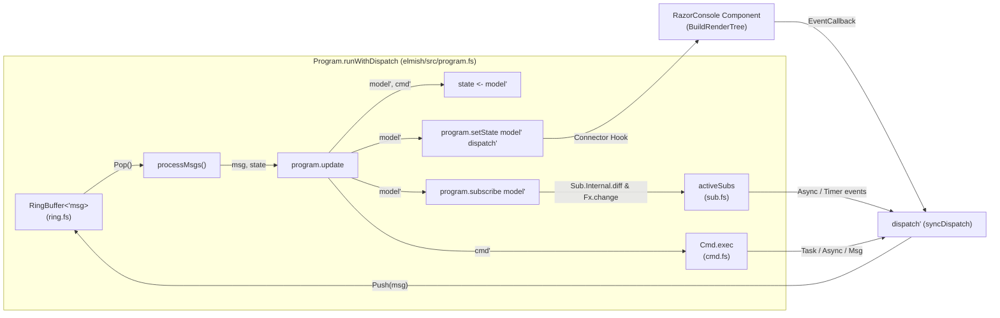

# Elmish, Bolero, and RazorConsole: Architecture and Connector Design

> 📘 **Looking for the active developer handbook, contracts, and TDD guide?**  
> See the companion document: [implementation_guide.md](implementation_guide.md).

---

## 1. Executive Summary

This document provides a comprehensive architectural investigation into:

1. **Foundational Microsoft Learn References**: Core Blazor architectural concepts (lifecycle, render tree building, synchronization context, event callbacks, custom renderers) for understanding how components work under the hood.
2. **RazorConsole** (`RazorConsole.Core`): How it hosts Razor components, runs its custom Blazor `Renderer`, translates virtual DOM diffs to Spectre.Console renderables, manages terminal focus and input, and triggers re-renders.
3. **Elmish Core Internals (`Elmish`)**: Detailed symbol-level analysis of every Elmish core type and module (`Program`, `Dispatch`, `Effect`, `Cmd`, `Sub`, `RingBuffer`, and `Program.runWithDispatch`) needed to write the `RazorConsole.Elmish` binding.
4. **Bolero Implementation Reference & Ecosystem Comparison**: Concise reference of Bolero's Blazor bridge (`Node` delegate and `ProgramComponent` lifecycle) and why a native `RazorConsole.Elmish` connector is preferred over hosting Bolero directly.
5. **Exhaustive HTML Support Matrix in RazorConsole**: Exactly which tags are translated by RazorConsole's middleware pipeline and how unsupported elements are handled.
6. **Empirical Performance Benchmarks**: Direct `RenderTreeBuilder` emission vs. Component `RenderFragment` composition, analyzing tree generation speed, partial update penalties, and Amdahl's Law in terminal pipelines.
7. **Primary Source Citation Index**: Grounded references citing files, symbols, and interfaces across all reviewed repositories without fragile line numbers.

---

## 2. Foundational Microsoft Learn References (Razor/Blazor Architecture)

To understand how RazorConsole renders Razor components to a terminal and how Elmish integrates with it, familiarity with Microsoft Blazor's architectural building blocks is essential. The following first-party guides and API references on Microsoft Learn explain these core concepts:

### 2.1 The Component Lifecycle & Rendering Model

* **[ASP.NET Core Razor component lifecycle](https://learn.microsoft.com/en-us/aspnet/core/blazor/components/lifecycle)**
  * **Core Concept:** Explains the order of execution for `SetParametersAsync`, `OnInitialized`, `OnInitializedAsync`, and `OnAfterRender(bool firstRender)`.
  * **Why it matters for Elmish:** Explains why `init` model must be produced in `OnInitialized` to avoid an empty initial render tree, and why the asynchronous Elmish loop (`Program.runWith`) must be deferred to `OnAfterRender(firstRender = true)`.
* **[ASP.NET Core Razor component rendering](https://learn.microsoft.com/en-us/aspnet/core/blazor/components/rendering)**
  * **Core Concept:** How Blazor decides when to re-render, how `ComponentBase` queues render batches, and how calling `StateHasChanged()` signals that component state has been updated.
  * **Why it matters for Elmish:** This is the exact mechanism Elmish uses in `setState` to request a visual refresh when the model changes.

### 2.2 Low-Level Render Tree Construction & Linear Diffing

* **[ASP.NET Core Blazor advanced scenarios (render tree construction)](https://learn.microsoft.com/en-us/aspnet/core/blazor/advanced-scenarios)**
  * **Core Concept:** Explains how the Razor compiler transforms `.razor` tags into C# calls on `RenderTreeBuilder`, and how Blazor's diffing engine achieves $O(N)$ linear-time performance.
  * **Critical Concept — Sequence Numbers:** Sequence numbers indicate source code call sites, not runtime execution counters (`seq++`). Generating runtime sequence numbers corrupts the diff algorithm.
  * **Critical Concept — `OpenRegion`:** Explains how `builder.OpenRegion` isolates dynamic collections and subtrees so sequence shifts inside loops do not desynchronize sibling elements.
* **[`RenderTreeBuilder` Class API Reference](https://learn.microsoft.com/en-us/dotnet/api/microsoft.aspnetcore.components.rendering.rendertreebuilder)**
  * **Core Concept:** The low-level API for emitting frame entries: `OpenElement`, `CloseElement`, `AddAttribute`, `AddContent`, `OpenComponent<T>`, `SetKey`, and `OpenRegion`.
* **[`RenderFragment` Delegate Reference](https://learn.microsoft.com/en-us/dotnet/api/microsoft.aspnetcore.components.renderfragment)**
  * **Core Concept:** The foundational delegate `delegate void RenderFragment(RenderTreeBuilder builder)` representing arbitrary UI segments.

### 2.3 Threading, Dispatchers, and Concurrency

* **[ASP.NET Core Blazor synchronization context](https://learn.microsoft.com/en-us/aspnet/core/blazor/components/synchronization-context)**
  * **Core Concept:** Blazor enforces a single-threaded execution context per renderer. Components run within a specialized `SynchronizationContext` managed by a `Dispatcher`.
  * **Why it matters for Elmish:** Elmish commands (`Cmd.OfAsync`, `Cmd.OfTask`, timers, subscriptions) run on background thread pool threads. Attempting to call `StateHasChanged()` directly from a background thread triggers concurrency exceptions. All UI notifications must be marshaled via `ComponentBase.InvokeAsync(this.StateHasChanged)` onto the `Dispatcher`.
* **[`Dispatcher` Class API Reference](https://learn.microsoft.com/en-us/dotnet/api/microsoft.aspnetcore.components.dispatcher)**
  * **Core Concept:** Provides methods (`InvokeAsync`) to execute work on the component renderer's logical thread.

### 2.4 Event Callbacks & Inter-Component Communication

* **[ASP.NET Core Blazor event handling](https://learn.microsoft.com/en-us/aspnet/core/blazor/components/event-handling)**
  * **Core Concept:** Explains how event arguments (`ChangeEventArgs`, `MouseEventArgs`, `KeyboardEventArgs`) are dispatched and how parent components bind to child events without manual event wire-up or memory leak risks.
* **[`EventCallback` Struct](https://learn.microsoft.com/en-us/dotnet/api/microsoft.aspnetcore.components.eventcallback) & [`EventCallbackFactory` Class](https://learn.microsoft.com/en-us/dotnet/api/microsoft.aspnetcore.components.eventcallbackfactory)**
  * **Core Concept:** `EventCallback.Factory.Create` binds an event receiver component to a delegate action. RazorConsole's terminal input manager triggers these callbacks automatically when keystrokes hit focused elements.

### 2.5 The Custom Renderer Extensibility Model

* **[`Renderer` Class API Reference](https://learn.microsoft.com/en-us/dotnet/api/microsoft.aspnetcore.components.rendertree.renderer)**
  * **Core Concept:** The abstract base class in `Microsoft.AspNetCore.Components.RenderTree` that manages component lifecycles, assigns integer component IDs, runs diffing passes, and yields `RenderBatch` structs.
  * **How RazorConsole fits in:** RazorConsole's `ConsoleRenderer` inherits directly from `Renderer`. It overrides `UpdateDisplayAsync(in RenderBatch batch)` to capture the diff stream and translate it into a terminal Virtual DOM (`VNode`) and Spectre.Console renderables rather than browser DOM mutations.

---

## 3. In-Depth Analysis of RazorConsole

RazorConsole enables rendering Blazor / Razor components directly into terminal windows using [Spectre.Console](https://spectreconsole.net/).

```text
+---------------------------------------------------------------------------------------+
|                                    RazorConsole Host                                  |
|                                                                                       |
|   +-----------------------+           +-------------------------------------------+   |
|   | Microsoft Generic Host| --------> | ComponentService<TComponent>              |   |
|   +-----------------------+           | (IHostedService / BackgroundService)      |   |
|                                       +---------------------+---------------------+   |
|                                                             |                         |
|                                                             v                         |
|   +-------------------------------------------------------------------------------+   |
|   |                        ConsoleRenderer : Renderer                             |   |
|   |                                                                               |   |
|   |   Dispatcher: Dispatcher.CreateDefault()                                      |   |
|   |   Component Roots: Dictionary<int, VNode>                                     |   |
|   |                                                                               |   |
|   |   MountComponentAsync() --------> RenderRootComponentAsync(componentId)       |   |
|   |                                               |                               |   |
|   |                                               v                               |   |
|   |   UpdateDisplayAsync(in RenderBatch batch)    |                               |   |
|   |     +-- ApplyComponentEdits() <---------------+                               |   |
|   |     +-- Updates in-memory VNode tree                                          |   |
|   |     +-- CreateSnapshot()                                                      |   |
|   |           |                                                                   |   |
|   |           v                                                                   |   |
|   |     TranslationContext / WidgetTranslationContext                             |   |
|   |           |                                                                   |   |
|   |           v                                                                   |   |
|   |     Spectre.Console IRenderable tree                                          |   |
|   |           |                                                                   |   |
|   |           +---------> EnqueueObserverNotification(snapshot)                   |   |
|   +-----------------------------------------------+-------------------------------+   |
|                                                   |                                   |
|                                                   v                                   |
|   +-------------------------------------------------------------------------------+   |
|   |                 ConsoleLiveDisplayContext : IObserver<RenderSnapshot>         |   |
|   |                                                                               |   |
|   |   OnNext(snapshot) -> UpdateView()                                            |   |
|   |     +-- VdomDiffService.Diff(previousRoot, currentRoot)                       |   |
|   |     +-- TryApplyMutations() (incremental updates on canvas)                   |   |
|   |     +-- Fallback: LiveDisplayCanvas.UpdateTarget(IRenderable)                 |   |
|   +-------------------------------------------------------------------------------+   |
|                               |                                                       |
|                               v                                                       |
|   +-------------------------------------------------------------------------------+   |
|   |                     Spectre.Console LiveDisplay Canvas                        |   |
|   |                        (Terminal ANSI Output)                                 |   |
|   +-------------------------------------------------------------------------------+   |
|           ^                                                       |                   |
|           | Terminal Key / Mouse Input                            |                   |
|           |                                                       |                   |
|   +-------+--------------------+                                  |                   |
|   | KeyboardEventManager       | <--------------------------------+                   |
|   | MouseEventManager          |                                                      |
|   | FocusManager               |                                                      |
|   +-------------+--------------+                                                      |
|                 |                                                                     |
|                 +---> ConsoleRenderer.DispatchEventAsync(handlerId, eventArgs)        |
|                         |                                                             |
|                         v                                                             |
|                       base.DispatchEventAsync(...) -> Blazor Component EventCallback  |
+---------------------------------------------------------------------------------------+
```

### 3.1 Application Hosting and Entry Point

The hosting entry point is defined in `RazorConsole.Core/AppHost.cs`:

* **`UseRazorConsole<TComponent>`**:
  Extension method on `IHostBuilder` and `IHostApplicationBuilder` with constraint `where TComponent : IComponent`.
* **`RegisterDefaults<TComponent>`**:
  Calls `services.AddRazorConsoleServices()` and registers `ComponentService<TComponent>` as an `IHostedService`.
* **`ComponentService<TComponent>`**:
  A `BackgroundService` that coordinates the lifecycle:
  1. Calls `RenderComponentInternalAsync`, which executes `consoleRenderer.MountComponentAsync<TComponent>`.
  2. Instantiates `ConsoleLiveDisplayContext` wrapping `LiveDisplayCanvas`, `consoleRenderer`, and `terminalMonitor`.
  3. Subscribes `FocusManager` to the renderer snapshot notifications.
  4. Starts background input loops (`keyboardEventManager.RunAsync` and `terminalMonitor.Start`).
  5. Waits for cancellation while keeping the terminal alive.

### 3.2 `ConsoleRenderer`: Blazor Renderer Specialization

The core rendering engine lives in `RazorConsole.Core/Rendering/ConsoleRenderer.cs`:

* **Inheritance & Interfaces**:
  Inherits directly from `Microsoft.AspNetCore.Components.RenderTree.Renderer` and implements `IObservable<ConsoleRenderer.RenderSnapshot>`.
* **Dispatcher**:
  Instantiates `Dispatcher.CreateDefault()`. All component lifecycle calls, parameter setting, and event dispatches are routed through this `Dispatcher`.
* **Component Roots Tracking**:
  Maintains `Dictionary<int, VNode> _componentRoots`, mapping Blazor component IDs to Virtual DOM node trees.
* **`UpdateDisplayAsync(in RenderBatch batch)`**:
  Overrides Blazor's abstract display update:
  1. Iterates `batch.UpdatedComponents`, invoking `ApplyComponentEdits(batch, diff)` to mutate the in-memory `VNode` tree.
  2. Removes disposed component trees from `_componentRoots`.
  3. Invokes `CreateSnapshot()` to translate the `VNode` hierarchy into a Spectre.Console `IRenderable` tree.
  4. Signals observers via `EnqueueObserverNotification(snapshot)`.
* **Event Dispatching**:
  `DispatchEventAsync(ulong eventHandlerId, EventFieldInfo? fieldInfo, EventArgs eventArgs)` routes incoming terminal events from `KeyboardEventManager` or mouse monitors back to Blazor's base event dispatcher, triggering component `EventCallback`s.

### 3.3 `ConsoleLiveDisplayContext` and Terminal Screen Updates

Defined in `RazorConsole.Core/Rendering/ConsoleLiveDisplayContext.cs`:

* Implements `IObserver<ConsoleRenderer.RenderSnapshot>`.
* In `OnNext(snapshot)`, converts the snapshot to a `ConsoleViewResult` and calls `UpdateView(view)`.
* Uses `VdomDiffService.Diff(previousRoot, currentRoot)` to compute mutations.
* If mutations can be applied incrementally (e.g. `UpdateText`, `UpdateAttributes`), it updates `_canvas` in-place. Otherwise, it executes a full redraw fallback via `_canvas.UpdateTarget(view.Renderable)`.

---

## 4. Elmish Core Internals: Types, Modules, and Dispatch Loop

Elmish (`elmish/src/`) is UI-agnostic. It does not define a virtual DOM, layout engine, or intermediate representation. Instead, it manages state transitions, message serialization, command execution, and subscription lifecycles across four core files: `cmd.fs`, `sub.fs`, `ring.fs`, and `program.fs`.



---

### 4.1 `Dispatch<'msg>`, `Effect<'msg>`, and `Cmd<'msg>` (`elmish/src/cmd.fs`)

Commands represent side effects (tasks, async workflows, timers, or immediate follow-up messages) that can dispatch new messages back into the loop.

```fsharp
// Source: elmish/src/cmd.fs
type Dispatch<'msg> = 'msg -> unit
type Effect<'msg> = Dispatch<'msg> -> unit
type Cmd<'msg> = Effect<'msg> list
```

#### Core Types

* **`Dispatch<'msg>` (`'msg -> unit`):** The callback passed to views, commands, and subscriptions to push a new message into the Elmish loop.
* **`Effect<'msg>` (`Dispatch<'msg> -> unit`):** A function that returns `unit` immediately and invokes `dispatch` zero, one, or many times (synchronously or asynchronously).
* **`Cmd<'msg>` (`Effect<'msg> list`):** A standard F# list of effects. Because it is a plain list, `Cmd.none` is `[]` and `Cmd.batch` is `List.concat`.

#### Core Methods in `module Cmd`

```fsharp
// Source: elmish/src/cmd.fs (module Cmd)
let internal exec onError (dispatch: Dispatch<'msg>) (cmd: Cmd<'msg>) =
    cmd |> List.iter (fun call -> try call dispatch with ex -> onError ex)

let none : Cmd<'msg> = []

let ofEffect (effect: Effect<'msg>) : Cmd<'msg> = [effect]

let ofMsg (msg: 'msg) : Cmd<'msg> = [fun dispatch -> dispatch msg]

let batch (cmds: #seq<Cmd<'msg>>) : Cmd<'msg> = cmds |> List.concat

let map (f: 'a -> 'msg) (cmd: Cmd<'a>) : Cmd<'msg> =
    cmd |> List.map (fun g -> (fun dispatch -> f >> dispatch) >> g)
```

* **`Cmd.exec` (Internal):** Iterates through the effect list and calls each effect with `dispatch`. Notice that `try ... with` only catches synchronous exceptions thrown while *starting* the effect; asynchronous exceptions inside tasks or async blocks are caught by the `Cmd.OfTask` / `Cmd.OfAsync` builders.
* **`Cmd.ofEffect`:** Wraps a single `Dispatch<'msg> -> unit` function into a `Cmd<'msg>`. **Binding Use Case:** During component initialization, `RazorConsole.Elmish` uses `Cmd.ofEffect (fun dispatch -> ...)` to capture the live `dispatch` reference from `Program.runWith`.
* **`Cmd.ofMsg`:** Synchronously dispatches `msg` as soon as `Cmd.exec` runs.
* **`Cmd.map`:** Transforms a child component's `Cmd<'childMsg>` into a parent's `Cmd<'parentMsg>` by composing `f >> dispatch`.
* **`Cmd.OfFunc` (`either`, `perform`, `attempt`):** Executes a synchronous function `'a -> 'b` inside `try ... with` and dispatches `ofSuccess` or `ofError`.
* **`Cmd.OfAsync` / `Cmd.OfAsyncImmediate` (`either`, `perform`, `attempt`):** Runs an `Async<'b>` workflow via `Async.Start` (background thread pool) or `Async.StartImmediate` (current thread until first `let!`) and dispatches the result.
* **`Cmd.OfTask` / `Cmd.OfValueTask` (`either`, `perform`, `attempt`):** Starts a .NET `Task<'b>` or `ValueTask<'b>` using `TaskBuilder.task` and dispatches on completion.

> **Binding Impact:** `Cmd.OfAsync` and `Cmd.OfTask` invoke `dispatch` from background thread pool threads when the async work finishes. Therefore, `dispatch` (or the `setState` callback triggered by `dispatch`) cannot assume it is running on Blazor's `Dispatcher` thread.

---

### 4.2 Subscriptions: `SubId`, `Subscribe<'msg>`, and `Sub<'msg>` (`elmish/src/sub.fs`)

Subscriptions represent long-lived, model-dependent event sources (such as terminal resize monitors, intervals, or external event streams) whose lifecycles are reconciled automatically whenever the model updates.

```fsharp
// Source: elmish/src/sub.fs
type SubId = string list
type Subscribe<'msg> = Dispatch<'msg> -> IDisposable
type Sub<'msg> = (SubId * Subscribe<'msg>) list
```

#### Core Types

* **`SubId` (`string list`):** A hierarchical key (formatted via `String.Join("/", subId)`) that uniquely identifies an active subscription.
* **`Subscribe<'msg>` (`Dispatch<'msg> -> IDisposable`):** Starts the event source and returns an `IDisposable` handle. Elmish calls `.Dispose()` on this handle when the subscription's `SubId` is no longer returned by `program.subscribe model`.
* **`Sub<'msg>` (`(SubId * Subscribe<'msg>) list`):** The list of subscriptions that should be active for a given model state.

#### Core Methods in `module Sub` and `Sub.Internal`

```fsharp
// Source: elmish/src/sub.fs (module Sub & module Sub.Internal)
let none : Sub<'msg> = []
let batch (subs: #seq<Sub<'msg>>) : Sub<'msg> = subs |> List.concat

let map (idPrefix: string) (f: 'a -> 'msg) (sub: Sub<'a>) : Sub<'msg> =
    sub |> List.map (fun (subId, subscribe) ->
        idPrefix :: subId,
        fun dispatch -> subscribe (f >> dispatch))

// Internal diffing & lifecycle management:
let diff (activeSubs: (SubId * IDisposable) list) (sub: Sub<'msg>) =
    let keys = activeSubs |> List.map fst |> Set.ofList
    let dupes, newKeys, newSubs = NewSubs.calculate sub
    if keys = newKeys then
        dupes, [], activeSubs, []
    else
        let toKeep, toStop = activeSubs |> List.partition (fun (k, _) -> Set.contains k newKeys)
        let toStart = newSubs |> List.filter (fun (k, _) -> not (Set.contains k keys))
        dupes, toStop, toKeep, toStart
```

* **How Subscription Reconciliation Works (`Sub.Internal.diff` and `Sub.Internal.Fx.change`):**
  On every `update` step, Elmish calls `program.subscribe model'` and compares the returned `SubId` keys against `activeSubs: (SubId * IDisposable) list`:
  1. **`dupes`:** Duplicate `SubId` entries in the same `Sub<'msg>` list trigger `program.onError ("Duplicate SubId: ...", ex)`.
  2. **`toStop`:** Active subscriptions whose `SubId` disappeared from `sub'` have `sub.Dispose()` called via `Fx.tryStop`.
  3. **`toKeep`:** Active subscriptions whose `SubId` is still present are kept untouched (their `Subscribe` factory is **not** re-run).
  4. **`toStart`:** New `SubId` entries have `start dispatch` called via `Fx.tryStart`, and their returned `IDisposable` handles are appended to `activeSubs`.

> **Binding Impact:**
>
> 1. `activeSubs` is stored inside `Program.runWithDispatch`'s local closure, so the connector must use upstream `Program.runWith` / `Program.runWithDispatch` rather than reimplementing the loop.
> 2. When the Blazor component disposes (`IDisposable.Dispose`), Elmish must stop all `activeSubs`. You wire this through `Program.withTermination` (see Section 4.4).

---

### 4.3 Message Serialization Queue: `RingBuffer<'item>` (`elmish/src/ring.fs`)

Elmish processes messages sequentially through a dynamically resizing circular array (`RingBuffer<'item>`) so re-entrant `dispatch` calls never invert message order.

```fsharp
// Source: elmish/src/ring.fs
[<Struct>]
type internal RingState<'item> =
    | Writable of wx: 'item array * ix: int
    | ReadWritable of rw: 'item array * wix: int * rix: int

type internal RingBuffer<'item>(size) =
    member __.Pop() : 'item option
    member __.Push(item: 'item) : unit
```

* **`Writable(items, ix)`:** The buffer is currently empty; the next `Push` writes at `ix` and transitions the state to `ReadWritable`.
* **`ReadWritable(items, wix, rix)`:** Unprocessed messages exist between read index `rix` and write index `wix`. If `wix` catches up to `rix` on `Push`, `doubleSize` allocates a new array of double capacity and copies existing items in order.
* **Why it matters:** If `setState`, `view`, or a synchronous `Cmd` calls `dispatch` while a message is currently being processed, `RingBuffer.Push` queues the new message at the tail and returns immediately, preventing stack overflow and state corruption.

---

### 4.4 `Program<'arg, 'model, 'msg, 'view>` and `module Program` (`elmish/src/program.fs`)

`Program` is a private record holding all callbacks that define an Elmish application:

```fsharp
// Source: elmish/src/program.fs
type Program<'arg, 'model, 'msg, 'view> = private {
    init : 'arg -> 'model * Cmd<'msg>
    update : 'msg -> 'model -> 'model * Cmd<'msg>
    subscribe : 'model -> Sub<'msg>
    view : 'model -> Dispatch<'msg> -> 'view
    setState : 'model -> Dispatch<'msg> -> unit
    onError : (string * exn) -> unit
    termination : ('msg -> bool) * ('model -> unit)
}
```

Because the record fields are `private`, connectors inspect and transform a `Program` exclusively through functions in `module Program`:

#### 1. Constructors (`mkProgram` and `mkSimple`)

```fsharp
// Source: elmish/src/program.fs (module Program)
let mkProgram
    (init : 'arg -> 'model * Cmd<'msg>)
    (update : 'msg -> 'model -> 'model * Cmd<'msg>)
    (view : 'model -> Dispatch<'msg> -> 'view) =
    { init = init
      update = update
      view = view
      setState = fun model -> view model >> ignore
      subscribe = fun _ -> Sub.none
      onError = Log.onError
      termination = (fun _ -> false), ignore }
```

* Notice that default `setState` is `fun model -> view model >> ignore`. It evaluates `view` and discards the `'view` result! A UI connector **must** override `setState` (via `Program.withSetState` or `Program.map`) to capture `'view` or trigger a UI render pass.

#### 2. Accessors (`init`, `update`, `view`, `setState`, `onError`)

* `Program.init program` returns `program.init`.
* `Program.view program` returns `program.view`.
* `Program.setState program` returns `program.setState`.
* **Binding Use Case:** In `OnInitialized`, the component calls `Program.init this.Program this` and `Program.view this.Program initModel dispatch` directly before starting the loop.

#### 3. Transformation & Interception (`Program.map` and `Program.withSetState`)

```fsharp
// Source: elmish/src/program.fs (module Program)
let map mapInit mapUpdate mapView mapSetState mapSubscribe mapTermination
        (program: Program<'arg, 'model, 'msg, 'view>) =
    { init = mapInit program.init
      update = mapUpdate program.update
      view = mapView program.view
      setState = mapSetState program.setState
      subscribe = mapSubscribe program.subscribe
      onError = program.onError
      termination = mapTermination program.termination }
```

* `Program.map` allows a connector to wrap every stage of the `Program` pipeline without mutating user code:
  * **`mapInit`:** Replaces `program.init` so `Program.runWith` replays the already-computed `(initModel, binderCmd @ initCmd)` instead of executing `program.init` a second time.
  * **`mapSetState`:** Replaces `program.setState` so every model update checks `ShouldRender(oldModel, newModel)`, evaluates `program.view`, caches the resulting `Node`, and calls `this.InvokeAsync(this.StateHasChanged)`.
  * **`mapTermination`:** Can wrap the termination predicate to stop active subscriptions when the component is disposed.

#### 4. The Dispatch Loop Engine (`Program.runWithDispatch`)

```fsharp
// Source: elmish/src/program.fs (Program.runWithDispatch)
let runWithDispatch (syncDispatch: Dispatch<'msg> -> Dispatch<'msg>) (arg: 'arg) (program: Program<'arg, 'model, 'msg, 'view>) =
    let (model,cmd) = program.init arg
    let sub = program.subscribe model
    let toTerminate, terminate = program.termination
    let rb = RingBuffer 10
    let mutable reentered = false
    let mutable state = model
    let mutable activeSubs = Subs.empty
    let mutable terminated = false
    let rec dispatch msg =
        if not terminated then
            rb.Push msg
            if not reentered then
                reentered <- true
                processMsgs ()
                reentered <- false
    and dispatch' = syncDispatch dispatch // serialized dispatch
    and processMsgs () =
        let mutable nextMsg = rb.Pop()
        while not terminated && Option.isSome nextMsg do
            let msg = nextMsg.Value
            try
                if toTerminate msg then
                    Subs.Fx.stop program.onError activeSubs
                    terminate state
                    terminated <- true
                else
                    let (model',cmd') = program.update msg state
                    let sub' = program.subscribe model'
                    program.setState model' dispatch'
                    activeSubs <- Subs.diff activeSubs sub' |> Subs.Fx.change program.onError dispatch'
                    cmd' |> Cmd.exec (fun ex -> program.onError (sprintf "Error handling the message: %A" msg, ex)) dispatch'
                    state <- model'
            with ex ->
                program.onError (sprintf "Unable to process the message: %A" msg, ex)
            nextMsg <- rb.Pop()

    reentered <- true
    program.setState model dispatch'
    activeSubs <- Subs.diff activeSubs sub |> Subs.Fx.change program.onError dispatch'
    cmd |> Cmd.exec (fun ex -> program.onError (sprintf "Error intitializing:", ex)) dispatch'
    processMsgs ()
    reentered <- false
```

Key mechanics of `runWithDispatch` that govern `RazorConsole.Elmish`:

1. **Re-entrancy Guard (`reentered`):**
   * During startup (`reentered <- true`), `setState`, `Subs.Fx.change`, and `Cmd.exec` run before `processMsgs ()`. Any message dispatched synchronously inside `init`'s `Cmd` (e.g., `Cmd.ofMsg`) is pushed into `rb` without recursively invoking `processMsgs`, and is drained immediately at line `processMsgs ()`.
2. **Thread Safety and `syncDispatch`:**
   * `RingBuffer<'msg>` and `reentered` are plain mutable fields with **no lock**.
   * `Program.runWith arg program` passes `id` as `syncDispatch`. If a background `Cmd.OfTask` or timer `Sub` calls `dispatch'` concurrently with a terminal keystroke on the Blazor `Dispatcher` thread, `rb.Push` and `reentered` will race!
   * Calling `Program.runWithDispatch syncDispatch this mappedProgram` where `syncDispatch` marshals calls onto Blazor's `Dispatcher` (or serializes onto the synchronization context) guarantees that `dispatch`, `update`, `subscribe`, and `setState` always execute single-threaded on the Blazor renderer thread.
3. **Order of Operations per Message:**
   * `update msg state` → `subscribe model'` → `setState model' dispatch'` → `Subs.diff` / `Fx.change` → `Cmd.exec` → `state <- model'`.
   * Notice that `program.setState` runs **before** `cmd'` is executed, and `state <- model'` is assigned after `cmd'` is started (since any synchronous dispatch inside `cmd'` is queued in `rb` while `reentered = true`, it will read the updated `state` on the next `while` iteration).
4. **Termination & Subscription Cleanup (`toTerminate`):**
   * The only built-in way to dispose `activeSubs` (`Subs.Fx.stop program.onError activeSubs`) is when a message satisfies `toTerminate msg`.

---

## 5. Bolero Implementation Reference & Ecosystem Comparison

### 5.1 Bolero Reference Patterns Worth Preserving

While Bolero targets web Blazor, two of its core mechanisms in `Bolero/src/Bolero/` serve as direct implementation references for `RazorConsole.Elmish`:

1. **Sequence-Threading `Node` and `Attr` Delegates (`Bolero/src/Bolero/NodeTypes.fs` & `Node.fs`):**

   ```fsharp
   type Attr = delegate of receiver: obj * builder: RenderTreeBuilder * sequence: int -> int
   type Node = delegate of receiver: obj * builder: RenderTreeBuilder * sequence: int -> int
   ```

   * Avoids allocating intermediate virtual DOM records or nested `RenderFragment` closures.
   * Passes `receiver: obj` (the root `ComponentBase`) down the tree so interactive widgets can bind `EventCallback.Factory.Create(receiver, ...)` without extra closure captures.
   * Uses `builder.OpenRegion(seq)` / `builder.CloseRegion()` in `Node.ForEach` and `Node.Fragment` to isolate dynamic list lengths from sibling sequence numbers.

2. **Two-Phase `ProgramComponent` Lifecycle (`Bolero/src/Bolero/Components.fs`):**
   * Evaluates `Program.init` and `Program.view` synchronously in `OnInitialized` so the first render batch is populated.
   * Uses `Program.map` to replay `(initModel, binderCmd @ initCmd)` when `Program.runWith` is called in `OnAfterRenderAsync(firstRender = true)`.

### 5.2 Why Native `RazorConsole.Elmish` Instead of Bolero?

Bolero cannot be used directly as an idiomatic TUI framework on RazorConsole:

* **Web Service Injection:** Bolero's `ProgramComponent` injects browser-specific services (`[<Inject>] IJSRuntime`, `[<Inject>] INavigationInterception`) that do not exist in a console host.
* **HTML5 vs. Terminal Widgets:** Bolero's `Bolero.Html` DSL targets HTML tags, whereas RazorConsole relies on Spectre.Console layout attributes (`class="panel"`, `data-layout`, `data-header`) and terminal-focusable components (`<TextInput>`, `<TextButton>`, `<Select>`).

### 5.3 Cross-Connector Comparison Table

| Feature / Dimension | Fable.React / Feliz | Bolero | Elmish.WPF | Avalonia.FuncUI | RazorConsole.Elmish |
| :--- | :--- | :--- | :--- | :--- | :--- |
| **`'view` Type Parameter** | `ReactElement` | `Bolero.Node` | `Bindings<'model, 'msg>` | `IView` | `RazorConsole.Elmish.Node` |
| **Host Environment** | Browser DOM | Microsoft Blazor (Web) | WPF (`FrameworkElement`) | Avalonia (`ElmishHostControl`) | RazorConsole (`ConsoleRenderer`) |
| **Intermediate Representation** | React Virtual DOM | Blazor `RenderTreeFrame` array | Direct `DependencyProperty` bindings | FuncUI Virtual Control Tree | Blazor frames -> RazorConsole `VNode` tree |
| **Diffing & Reconciliation** | React fiber diffing | Blazor `Renderer` (`RenderBatch`) | WPF native layout engine | Custom FuncUI diff/patch engine | Blazor diff -> `ConsoleRenderer` -> `VdomDiffService` |
| **Screen Materialization** | Browser DOM elements | Browser DOM via WASM/SignalR | DirectX / MilCore | Skia / Direct2D | Spectre.Console `IRenderable` -> ANSI canvas |
| **Thread Marshaling** | Single-threaded JS loop | `ComponentBase.InvokeAsync` | `Dispatcher.Invoke` | `Dispatcher.UIThread.InvokeAsync` | `ComponentBase.InvokeAsync` onto Blazor `Dispatcher` |
| **Event Routing** | Synthetic React events | Blazor `EventCallback` -> `dispatch` | WPF `ICommand` -> `dispatch` | Native Avalonia events -> `dispatch` | Terminal input -> `KeyboardEventManager` -> `EventCallback` -> `dispatch` |

> 📘 **For the active implementation contracts, 5-phase roadmap, and TDD progression, see [implementation_guide.md](implementation_guide.md).**
---

## 6. Exhaustive HTML Support Matrix in RazorConsole

RazorConsole translates a strictly bounded subset of HTML elements into Spectre.Console renderables via dedicated translation middlewares.

| Category | Supported HTML Tags | Primary Source Middleware | Translation Target / Behavior |
| :--- | :--- | :--- | :--- |
| **Containers / Blocks** | `<div>` | `HtmlDivElementTranslator` | Translated to `BlockInlineRenderable`. Divs with special classes (`panel`, `rows`, `columns`, `grid`) or data attributes (`data-button`, `data-spacer`, `data-newline`) are delegated to specialized layout translators. |
| | `<p>` | `HtmlParagraphElementTranslator` | Child nodes converted to renderables; multiple children wrapped in `Columns(Expand=false, Padding=0)`. |
| | `<blockquote>` | `HtmlBlockquoteElementTranslator` | Quoted block with indent/border. |
| | `<hr>` | `HtmlHrElementTranslator` | Rendered as a horizontal rule via Spectre `Rule`. |
| | `<pre>` with `<code>` | `HtmlCodeBlockElementTranslator` | Syntax-highlighted code block using `SyntaxHighlightingService`. |
| **Headings** | `<h1>` through `<h6>` | `HtmlHeadingElementTranslator` | Prefixed with `#`, `##`, `###` etc. and styled with Spectre headings. |
| **Lists** | `<ul>`, `<ol>`, `<li>` | `HtmlListElementTranslator` | Rendered as bulleted (`*`) or numbered (`1.`) lines. |
| **Tables** | `<table>`, `<thead>`, `<tbody>`, `<tfoot>`, `<tr>`, `<th>`, `<td>` | `HtmlTableElementTranslator` | Translated to a full Spectre.Console `Table` with border styles and cells. |
| **Buttons** | `<button>` | `HtmlButtonElementTranslator` | Focusable button renderable with click/key handlers. |
| **Inline Formatting** | `<strong>`, `<b>` | `HtmlInlineTextElementTranslator` | `[bold]` Spectre markup |
| | `<em>`, `<i>`, `<cite>` | `HtmlInlineTextElementTranslator` | `[italic]` Spectre markup |
| | `<mark>` | `HtmlInlineTextElementTranslator` | `[black on yellow]` Spectre markup |
| | `<del>` | `HtmlInlineTextElementTranslator` | `[strikethrough]` Spectre markup |
| | `<ins>`, `<abbr>` | `HtmlInlineTextElementTranslator` | `[underline]` Spectre markup |
| | `<code>` | `HtmlInlineTextElementTranslator` | `[indianred1 on #1f1f1f]` Spectre markup |
| | `<small>`, `<sub>`, `<sup>` | `HtmlInlineTextElementTranslator` | `[dim]` Spectre markup |
| | `<q>` | `HtmlInlineTextElementTranslator` | Unicode quotes (`“...”`) |
| | `<a>` | `HtmlInlineTextElementTranslator` | Underlined link markup |

### Behavior on Unsupported HTML Tags

If an application outputs an HTML tag not listed above (such as `<section>`, `<article>`, `<header>`, `<footer>`, `<input>`, `<select>`), RazorConsole does **not** silently drop it. Instead, **`FallbackTranslator`** intercepts it and renders a red diagnostic panel directly on the terminal:

```text
+-----------------------------------------------+
| [red]Untranslated VDOM[/] • <section>         |
+-----------------------------------------------+
```

---

## 7. Empirical Performance Benchmark: RenderFragment vs. Direct RenderTreeBuilder

A central architectural question for `RazorConsole.Elmish` is whether the Elmish `view` function should emit a tree of Blazor components via `RenderFragment` delegates, or directly drive `RenderTreeBuilder.OpenElement` inside a single root component.

### 7.1 Resolution of the Initial Benchmark Anomaly

Early prototype benchmarks initially produced an unexpected result where the Component Path appeared faster because:

1. **Asymmetric Update Propagation:** The component path's child components were not receiving updated parameters, causing Blazor to short-circuit and skip re-rendering child components (measuring a virtually no-op parent render).
2. **VDOM Structure Divergence:** The direct element path omitted layout attributes and text spans, testing an entirely different element structure against RazorConsole's translator.

### 7.2 Normalized Empirical Findings

When the benchmark harness (`benchmarks/Program.fs`) was normalized so that both approaches generate **100% character-identical Virtual DOM trees** across all frames (verified via `VdomHtmlSerializer` string assertions), the true performance relationship emerged:

#### Benchmark Results (BenchmarkDotNet v0.15.8, .NET 10.0.12, Intel Core Ultra 9 185H)

| Scenario | Mode | Component Tree Mean | Direct Builder Mean | Speedup | Component Tree Alloc | Direct Builder Alloc | Alloc Ratio |
| :--- | :--- | ---: | ---: | ---: | ---: | ---: | ---: |
| **Full Update (50 items)** | `PureBlazor` | 76.54 μs | **25.43 μs** | **3.01x** | 57.54 KB | **34.01 KB** | **0.59x** (-40.9%) |
| **Partial Update (1 of 50 items)** | `PureBlazor` | 61.40 μs | **24.46 μs** | **2.51x** | 42.69 KB | **31.41 KB** | **0.55x** (-45.2%) |
| **Structural Mutation (50 ↔ 51)** | `PureBlazor` | 72.91 μs | **26.53 μs** | **2.75x** | 52.76 KB | **34.35 KB** | **0.60x** (-40.2%) |
| **Full Update (50 items)** | `ConsoleRenderer` | 221.03 μs | **153.28 μs** | **1.44x** | 293.79 KB | **262.57 KB** | **0.89x** (-10.6%) |
| **Partial Update (1 of 50 items)** | `ConsoleRenderer` | 184.12 μs | **134.26 μs** | **1.37x** | 269.29 KB | **244.96 KB** | **0.83x** (-9.0%) |
| **Structural Mutation (50 ↔ 51)** | `ConsoleRenderer` | 204.26 μs | **144.16 μs** | **1.42x** | 288.55 KB | **256.90 KB** | **0.87x** (-11.0%) |

### 7.3 Key Empirical Insights

1. **Pure Tree-Building Speed:** In isolation (`PureBlazor`), direct `RenderTreeBuilder` emission is **2.5x to 3.0x faster** and allocates **~40% to 45% less memory** (0.55x–0.60x allocation ratio) than a component hierarchy.
2. **Component Boundary Penalty on Partial Updates:** Even when only 1 item out of 50 changes, the Component Tree still takes **61.40 μs** in `PureBlazor`. Because `ChildContent` delegates are re-instantiated closures, Blazor cannot prove parameter equality and forces `SetParametersAsync` traversals across all 50 components. In contrast, Direct Builder completes in **24.46 μs** because Blazor diffs the single tree in memory and generates **0 edits** for the 49 unchanged items.
3. **Amdahl's Law in RazorConsole:** Under `ConsoleRenderer`, widget translation (`CreateSnapshot`) adds a flat baseline cost of **~110–130 μs** and **~220 KB of allocations** per frame to both approaches. This fixed overhead compresses the observed speedup from **~3.0x** down to **~1.4x** (saving **~50 to ~68 μs** per frame).
4. **VDOM Equivalence:** The benchmark harness (`Program.fs`) verified that the Direct Element tree generates **100% character-identical Virtual DOM serialization** as the Component tree across all initial, full, partial, and structural update scenarios.

---

## 8. Primary Source Citation Index

References are cited by repository, file path, and public entity/symbol rather than fluid line numbers:

| Repository | File Path | Symbol / Entity / Topic |
| :--- | :--- | :--- |
| **Benchmark** | `benchmarks/Program.fs` | `RazorConsoleBenchmark`, `PureBlazorRenderer`, `runVerification` |
| **Elmish** | `src/program.fs` | `type Program<'arg, 'model, 'msg, 'view>`, `Program.mkProgram`, `Program.mkSimple`, `Program.map`, `Program.withSetState`, `Program.withSubscription`, `Program.withTermination`, `Program.runWithDispatch`, `Program.runWith` |
| **Elmish** | `src/cmd.fs` | `type Dispatch<'msg>`, `type Effect<'msg>`, `type Cmd<'msg>`, `Cmd.exec`, `Cmd.ofEffect`, `Cmd.ofMsg`, `Cmd.map`, `Cmd.batch`, `Cmd.OfFunc`, `Cmd.OfAsync`, `Cmd.OfTask`, `Cmd.OfValueTask` |
| **Elmish** | `src/sub.fs` | `type SubId`, `type Subscribe<'msg>`, `type Sub<'msg>`, `Sub.none`, `Sub.batch`, `Sub.map`, `Sub.Internal.diff`, `Sub.Internal.Fx.change`, `Sub.Internal.Fx.stop` |
| **Elmish** | `src/ring.fs` | `type RingState<'item>`, `type RingBuffer<'item>` (`Push`, `Pop`, `doubleSize`) |
| **Elmish** | `src/prelude.fs` | `module Log` (`onError`, `toConsole`), `module AsyncHelpers` (`start`) |
| **Bolero** | `src/Bolero/NodeTypes.fs` | `type Attr`, `type Node` delegates |
| **Bolero** | `src/Bolero/Components.fs` | `ProgramComponent<'model, 'msg>`, `ForceSetState`, `BuildRenderTree` |
| **Bolero** | `src/Bolero/Node.fs` | `Node.Empty`, `Node.Elt`, `Node.Text`, `Node.ForEach` (`OpenRegion`), `Node.Fragment` |
| **Bolero** | `src/Bolero.Html/Builders.fs` | `ConcatBuilder`, `AttrBuilder` struct computation expressions |
| **RazorConsole** | `src/RazorConsole.Core/AppHost.cs` | `UseRazorConsole<TComponent>`, `ComponentService<TComponent>` background lifecycle |
| **RazorConsole** | `src/RazorConsole.Core/Rendering/ConsoleRenderer.cs` | `ConsoleRenderer : Renderer`, `_dispatcher`, `MountComponentAsync`, `UpdateDisplayAsync`, `CreateSnapshot` |
| **RazorConsole** | `src/RazorConsole.Core/Rendering/ConsoleLiveDisplayContext.cs` | `ConsoleLiveDisplayContext : IObserver<RenderSnapshot>`, `UpdateView`, `VdomDiffService` |
| **RazorConsole** | `src/RazorConsole.Core/Input/KeyboardEventManager.cs` | `KeyboardEventManager.RunAsync`, terminal input decoding, `DispatchEventAsync` |
| **RazorConsole** | `src/RazorConsole.Core/Focus/FocusManager.cs` | Terminal keyboard focus tracking and focus session management |
| **RazorConsole** | `src/RazorConsole.Core/RazorConsoleServiceCollectionExtensions.cs` | `AddRazorConsoleServices`, default DI middleware registrations |
| **RazorConsole** | `src/RazorConsole.Core/Rendering/Translation/Translators/HtmlParagraphElementTranslator.cs` | HTML `<p>` translation into Spectre `Columns` |
| **RazorConsole** | `src/RazorConsole.Core/Rendering/Translation/Translators/HtmlDivElementTranslator.cs` | HTML `<div>` translation and class/data-attr layout delegation |
| **RazorConsole** | `src/RazorConsole.Core/Rendering/Translation/Translators/HtmlTableElementTranslator.cs` | HTML `<table>`, `thead`, `tbody`, `tr`, `th`, `td` translation into Spectre `Table` |
| **RazorConsole** | `src/RazorConsole.Core/Rendering/Translation/Translators/HtmlHeadingElementTranslator.cs` | HTML `<h1>` through `<h6>` translation |
| **RazorConsole** | `src/RazorConsole.Core/Rendering/Translation/Translators/HtmlInlineTextElementTranslator.cs` | Inline HTML formatting tags (`strong`, `em`, `code`, `mark`, etc.) translation |
| **RazorConsole** | `src/RazorConsole.Core/Rendering/Translation/Translators/FallbackTranslator.cs` | Diagnostic red panel fallback for unsupported HTML/VDOM tags |
| **RazorConsole** | `src/RazorConsole.Core/Components/Box.razor` | `<Box>` layout attributes (`Padding`, `Margin`, `Width`, `Height`, `Expand`, `Border`) |
| **RazorConsole** | `src/RazorConsole.Core/Components/Panel.razor` | `<Panel>` component wrapping `<Box>` with `Title`, `BorderColor`, etc. |
| **RazorConsole** | `src/RazorConsole.Core/Components/TextInput.razor` | `<TextInput>` focusable input component with two-way binding |
| **RazorConsole** | `src/RazorConsole.Core/Components/TextButton.razor` | `<TextButton>` focusable button component with click handling |
