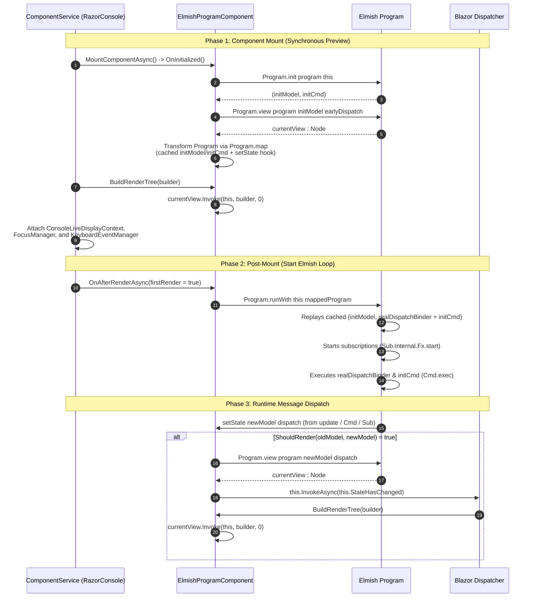

# RazorConsole.Elmish: Implementation Guide & TDD Handbook

This handbook is the practical development reference for implementing **`RazorConsole.Elmish`**. It contains architectural contracts, the step-by-step implementation roadmap, performance engineering guidelines, and the Test-Driven Development (TDD) progression.

> ℹ️ For the foundational research on Elmish core, Bolero, and RazorConsole internals, see [elmish_razorconsole_architecture.md](elmish_razorconsole_architecture.md).

---

## 1. Architectural Contracts & Implementation Hints

Following Bolero's design (`Bolero/src/Bolero/NodeTypes.fs` and `Components.fs`), the connector architecture is built around the sequence-threading `Node` delegate, directly driving `RenderTreeBuilder` with zero `RenderFragment` allocation overhead.

### 1.1 Core View Delegates (`Node` and `Attr`)

```fsharp
namespace RazorConsole.Elmish

open Microsoft.AspNetCore.Components.Rendering

/// Emits HTML attributes or Blazor parameters directly into the builder.
type Attr = delegate of receiver: obj * builder: RenderTreeBuilder * sequence: int -> int

/// Emits HTML elements or Blazor component frames directly into the builder.
type Node = delegate of receiver: obj * builder: RenderTreeBuilder * sequence: int -> int
```

* **Role of `receiver: obj`:** Represents the root component instance. Essential when creating Blazor event callbacks (`EventCallback.Factory.Create`), as Blazor binds callbacks to an owning receiver for lifecycle and dispatch tracking.
* **Role of `sequence: int -> int`:** Chains frame positions through the tree, guaranteeing each element or attribute receives an explicit index before returning the next available slot.

---

### 1.2 Root Component Contract (`ElmishProgramComponent<'model, 'msg>`)

`ElmishProgramComponent<'model, 'msg>` connects the Elmish loop to the Blazor component lifecycle in RazorConsole.

```fsharp
[<AbstractClass>]
type ElmishProgramComponent<'model, 'msg>() =
    inherit ComponentBase()

    /// Abstract program specification parameterized on Node
    abstract Program: Program<ElmishProgramComponent<'model, 'msg>, 'model, 'msg, Node>

    /// Safe message dispatch entry point
    member Dispatch: 'msg -> unit

    /// Re-render predicate (defaults to reference equality check)
    abstract ShouldRender: oldModel: 'model * newModel: 'model -> bool

    // Lifecycle overrides to implement:
    override OnInitialized: unit -> unit
    override OnAfterRenderAsync: firstRender: bool -> Task
    override BuildRenderTree: builder: RenderTreeBuilder -> unit
```

#### Reference: Upstream Elmish Loop (`elmish/src/program.fs`)

In upstream Elmish, `Program.runWithDispatch` executes the entire startup sequence in one synchronous pass:

```fsharp
// Simplified from elmish/src/program.fs (Program.runWithDispatch)
let (model, cmd) = program.init arg
let sub = program.subscribe model
let toCreate = Sub.Internal.diff Sub.Internal.empty sub
program.setState model syncDispatch
let activeSubs = Sub.Internal.Fx.start program.onError syncDispatch toCreate
Cmd.exec program.onError syncDispatch cmd
rb.Drain() // Drains any messages dispatched synchronously during startup
```

Note two constraints from `elmish/src/program.fs`:

1. `Program.runWith` executes `init`, `setState`, `subscribe`, and `Cmd.exec` immediately in one call.
2. `activeSubs` (the list of active subscription dispose handles) is a local variable inside the private `runWithDispatch` closure. External code cannot access `activeSubs`.

#### Why Startup Must Be Split Across Two Lifecycle Methods

RazorConsole starts a component in `ComponentService<TComponent>` (`RazorConsole.Core/AppHost.cs`) in two stages:

1. **Stage 1 (`MountComponentAsync`):** RazorConsole runs `OnInitialized`, calls `BuildRenderTree`, builds the initial `VNode` tree, and schedules `OnAfterRenderAsync(firstRender = true)`.
2. **Stage 2 (Post-Mount):** After `MountComponentAsync` returns, `ComponentService` attaches `ConsoleLiveDisplayContext` (the live terminal canvas), registers `FocusManager`, and starts `KeyboardEventManager.RunAsync`.

This order creates two requirements:

* **Do not wait until `OnAfterRenderAsync` to call `init` and `view`:** If `OnInitialized` does nothing, the first `BuildRenderTree` pass emits an empty frame before the real UI appears.
* **Do not call `Program.runWith` in `OnInitialized`:** If `Program.runWith` runs in `OnInitialized`, initial commands (`initCmd`) and subscriptions (`subscribe`) start before the live display canvas, focus session, and keyboard loop exist. Also, a synchronous command (such as `Cmd.ofMsg`) dispatches immediately during `OnInitialized` and triggers a re-render while the initial mount is still in progress.

Because `activeSubs` is private to `runWithDispatch`, do not write a custom loop that splits `init` from `Cmd.exec`. Instead, use the two-phase **Eager-Init + Replay-on-Run** pattern from Bolero (`Bolero/src/Bolero/Components.fs`):



#### Implementation Rules

1. **Rule 1 — Eager Initialization in `OnInitialized`:**
   * Call `Program.init this.Program this` to get `(initModel, initCmd)`. Do not execute `initCmd` yet.
   * Call `Program.view this.Program initModel (fun msg -> this.Dispatch msg)` and store the returned `Node` in a mutable field (`currentView`). This guarantees that the first `BuildRenderTree` pass renders the initial state.
   * Store `initModel` as the baseline for `ShouldRender`.
   * Use `Program.map` to wrap the program before storing it:
     * **Mapped `init`:** Return `initModel` and prepend a custom command `[ fun dispatch -> this.BindDispatch(dispatch) ]` to `initCmd`. When `Program.runWith` runs later, it receives the cached `initModel` without calling the user's `init` function a second time, and captures the live Elmish `dispatch` function.
     * **Mapped `setState`:** Intercept model updates (see Rule 2).

2. **Rule 2 — State Interception (`setState`):**
   * When Elmish calls `setState newModel dispatch`:
     * Compare the previous model with `newModel` using `this.ShouldRender(oldModel, newModel)`.
     * If `ShouldRender` returns `true`, evaluate `Program.view` to update `currentView`, store `newModel`, and request a Blazor render pass.

3. **Rule 3 — Thread Marshaling (`InvokeAsync`):**
   * Elmish commands (`Cmd.OfAsync`, `Cmd.OfTask`) and subscriptions (such as timers) execute on background threads.
   * Blazor's `ConsoleRenderer` requires all component state notifications to run on its single-threaded `Dispatcher`.
   * Always call `this.InvokeAsync(this.StateHasChanged) |> ignore` inside `setState`. Never call `this.StateHasChanged()` directly, or background threads will throw synchronization exceptions.

4. **Rule 4 — Loop Startup in `OnAfterRenderAsync`:**
   * When `firstRender` is `true`, call `Program.runWith this mappedProgram`.
   * Because `mappedProgram` returns the cached `(initModel, binderCmd @ initCmd)`, upstream `Program.runWith` binds `this.Dispatch`, starts subscriptions (`subscribe`), and executes `initCmd` after the terminal canvas and input loops are active.

5. **Rule 5 — Frame Emission in `BuildRenderTree`:**
   * Invoke `currentView.Invoke(this, builder, 0) |> ignore` to write the current `Node` delegate into the `RenderTreeBuilder` starting at sequence number `0`.

---

### 1.3 Declarative View Signatures (`View.fs`)

Functions producing `Node` delegates for terminal UI composition:

```fsharp
module View =
    val empty: Node
    val text: string -> Node
    val markup: string -> Node
    val panel: title: string -> border: string -> child: Node -> Node
    val rows: children: seq<Node> -> Node
    val columns: children: seq<Node> -> Node
    val textInput: value: string -> placeholder: string -> onChanged: (string -> 'msg) -> dispatch: ('msg -> unit) -> Node
    val button: content: string -> onClick: 'msg -> dispatch: ('msg -> unit) -> Node
    val forEach: items: seq<'T> -> mkNode: ('T -> Node) -> Node
    val fragment: RenderFragment -> Node
```

**Conceptual Hints:**

* **Layout Containers (Direct Frames):** Emit elements directly using `builder.OpenElement`, assign attributes (`class`, `data-layout`, `data-header`), invoke children, and close with `builder.CloseElement`.
* **Interactive Widgets (Component Frames):** Emit component frames (`builder.OpenComponent<TextInput>`), bind parameters, and wire event callbacks via `EventCallback.Factory.Create`.
* **Sequence Isolation (`forEach`):** When rendering dynamic or variable-length lists, wrap the loop inside `builder.OpenRegion(seq) ... builder.CloseRegion()`. This prevents list mutations (insertions/removals) from shifting subsequent sibling sequence numbers and preserves linear-time diffing.
* **Escape Hatch (`fragment`):** Wrap external `RenderFragment` delegates inside `OpenRegion` to isolate foreign sequence numbers from the rest of the tree.

---

### 1.4 Generic Host Integration Contract

Provide standard extension methods for `IHostBuilder` and `IHostApplicationBuilder`:

```fsharp
[<Extension>]
type HostBuilderExtensions =
    [<Extension>]
    static member UseRazorConsoleElmish<'TComponent, 'model, 'msg
        when 'TComponent :> ElmishProgramComponent<'model, 'msg> and 'TComponent : (new: unit -> 'TComponent)>
        : builder: IHostBuilder -> IHostBuilder
```

**Conceptual Hints:**

* Forward directly to `RazorConsole.Core`'s `builder.UseRazorConsole<'TComponent>()`. RazorConsole's `ComponentService<TComponent>` will mount your `ElmishProgramComponent` as the application's root component.

---

## 2. Step-by-Step Implementation Roadmap

```text
+-----------------------------------------------------------------------------------+
|                              Implementation Roadmap                               |
|                                                                                   |
|   [Phase 1] Project Setup & Dependencies                                          |
|             * Create F# classlib & sample console app                             |
|             * Reference Elmish, Microsoft.AspNetCore.Components, RazorConsole.Core |
|                                     │                                             |
|                                     ▼                                             |
|   [Phase 2] Core Runtime Bridge (ElmishProgramComponent)                          |
|             * Implement ComponentBase subclass parameterized on Node              |
|             * Wire Program.init, setState, InvokeAsync, and runWith               |
|             * Verify with a simple counter emitting OpenElement("h1")             |
|                                     │                                             |
|                                     ▼                                             |
|   [Phase 3] High-Performance Direct View Combinators (View.fs)                    |
|             * Direct frame layouts: Panel, Rows, Columns, Markup (zero alloc)     |
|             * Component frames: TextInput, Button with EventCallback binding      |
|             * Dynamic list isolation via forEach & OpenRegion                     |
|                                     │                                             |
|                                     ▼                                             |
|   [Phase 4] Struct Computation Expression DSL (Dsl.fs)                            |
|             * Implement struct Container Builders (rows, columns) with Yield / For|
|             * Implement Component Builders (panel, box) with Custom Operations    |
|             * Implement Input Builders (textInput, button)                        |
|                                     │                                             |
|                                     ▼                                             |
|   [Phase 5] Verification, Focus, and Edge Cases                                   |
|             * Tab navigation & focus ring validation                              |
|             * Async commands & timer subscriptions (concurrency marshaling)       |
|             * Terminal resize behavior                                            |
+-----------------------------------------------------------------------------------+
```

### Phase 1: Project Setup & Dependencies

* Create an F# class library project (`RazorConsole.Elmish`) targeting `.NET 8.0` or `.NET 9.0`.
* Add package references to `Elmish`, `Microsoft.AspNetCore.Components`, and reference `RazorConsole.Core`.
* Create a companion console app (`samples/CounterApp`) to exercise each milestone interactively.

### Phase 2: Core Runtime Bridge (ElmishProgramComponent)

* **Milestone Goal:** Establish the two-way MVU loop inside RazorConsole before writing any high-level combinators.
* Implement `Node` delegate and `ElmishProgramComponent<'model, 'msg>`.
* Implement eager-init + lazy-`runWith` across the lifecycle: `OnInitialized` evaluates `Program.init`, previews the initial `Node` via `Program.view`, maps the program to replay the cached init (dispatch binder prepended) and intercept `setState`, and binds `Dispatch`; `OnAfterRenderAsync` (`firstRender = true`) runs the standard `Program.runWith` so init-`Cmd` and subscriptions start only after mount; `setState` marshals via `InvokeAsync`.
* **Verification Gate:** Write a minimal counter where `view` is a raw `Node` writing an `<h1>` tag with `OpenElement`. Confirm that state increments update the terminal output cleanly without exceptions.

### Phase 3: High-Performance Direct View Combinators (View.fs)

* **Milestone Goal:** Build the functional API wrapping RazorConsole's layout elements and interactive widgets.
* Implement direct element wrappers for layout (`panel`, `rows`, `columns`, `markup`).
* Implement component frame wrappers for interactive controls (`textInput`, `button`), connecting event callbacks to message dispatches.
* Implement `forEach` using `OpenRegion` to isolate dynamic sequences.
* **Verification Gate:** Build a multi-item list with a text input and buttons. Verify that typing and clicking trigger updates correctly.

### Phase 4: Struct Computation Expression DSL (Dsl.fs)

* **Milestone Goal:** Provide declarative `{ ... }` syntax using zero-allocation struct builders.
* Use `[<Struct; NoComparison; NoEquality>]` on builder types with `[<InlineIfLambda>]` on delegate arguments.
* Implement container builders supporting `Yield`, `Combine`, `Delay`, `Run`, `Zero`, and `For`.
* Implement widget builders using `[<CustomOperation>]` for attributes (`title`, `border`, `padding`, `value`, `onChange`).
* **Verification Gate:** Rewrite the Phase 3 sample into clean CE DSL syntax.

### Phase 5: Verification, Focus, and Edge Cases

* **Keyboard Focus:** Validate that `Tab` and `Shift+Tab` navigate focus between multiple input controls.
* **Asynchronous Commands & Subscriptions:** Test background timers or async tasks to confirm thread marshaling works without synchronization errors.
* **Terminal Resizing:** Resize the terminal window during execution to verify that RazorConsole's layout re-measurement operates seamlessly.

---

## 3. Dual-Engine View Architecture: Balancing RenderFragment vs. Direct RenderTreeBuilder

### 3.1 The Unified `ViewNode` Abstraction

In ASP.NET Core, `RenderFragment` is defined as:

```csharp
public delegate void RenderFragment(RenderTreeBuilder builder);
```

The performance difference is not the delegate type itself, but **what gets emitted into `builder`**:

* Component Path: `builder.OpenComponent<Panel>()`
* Fast Path: `builder.OpenElement(seq, "div")` with class/data attributes

To allow both styles to coexist without forcing users into one camp, the core view type is modeled as a sequence-threading delegate:

```fsharp
type ViewNode = delegate of RenderTreeBuilder * int -> int
```

### 3.2 Bidirectional Adapter Layer with Region Isolation

```fsharp
[<RequireQualifiedAccess>]
module ViewNode =
    let empty : ViewNode = ViewNode(fun _ seq -> seq)

    /// High-throughput conversion: turns a ViewNode into a standard Blazor RenderFragment
    let toRenderFragment (node: ViewNode) : RenderFragment =
        RenderFragment(fun builder -> node.Invoke(builder, 0) |> ignore)

    /// Safe composition adapter: embeds any standard RenderFragment into a ViewNode.
    /// OpenRegion isolates the child fragment's internal sequence numbers!
    let ofRenderFragment (fragment: RenderFragment) : ViewNode =
        ViewNode(fun builder seq ->
            builder.OpenRegion(seq)
            fragment.Invoke(builder)
            builder.CloseRegion()
            seq + 1)
```

### 3.3 Natural Division of Labor in a TUI

```text
+──────────────────────────────────────────────────────────────────────────+
| Application Layout Tree                                                  |
|                                                                          |
|   View.Fast.rows [                  <-- Zero-allocation frame writer     |
|       View.Fast.panel "Logs" [      <-- Zero-allocation frame writer     |
|           for log in logs ->                                             |
|               View.Fast.text log    <-- Flat text frame (fast streaming) |
|       ]                                                                  |
|                                                                          |
|       View.Component.textInput [    <-- Full Blazor Component            |
|           // Complex widget with cursor, backspace, and focus            |
|       ]                                                                  |
|   ]                                                                      |
+──────────────────────────────────────────────────────────────────────────+
```

1. **High-Frequency Layouts (Streaming logs, dashboards, 60 FPS animations):**  
   Use `View.Fast.*` to write flat element frames directly into `RenderTreeBuilder`, avoiding dozens or hundreds of `ComponentBase` allocations per frame.
2. **Interactive & Focusable Widgets (`TextInput`, `Select`, `Button`):**  
   Use `View.Component.*` (or embed standard `.razor` components via `ViewNode.ofRenderFragment`), delegating complex keyboard focus, cursor management, and editing to RazorConsole's components.

---

## 4. Computation Expression (CE) DSL Guidelines

### 4.1 Value Proposition

1. **Elimination of Parameter Explosion:** Widgets like `<Panel>` and `<Box>` have 10+ optional parameters. CEs with `[<CustomOperation>]` make attributes optional, order-independent statements.
2. **Elimination of Bracket Noise:** Replaces nested `rows [ panel ... [ columns [ ... ] ] ]` with clean indentation and curly braces (`{ ... }`).
3. **Seamless Control Flow:** Attributes, children, and F# language constructs (`if/then/else`, `for item in items do`) live naturally inside the same block.

### 4.2 Zero-Allocation Struct Builders

Bolero’s `Builders.fs` defines its builders as structs (`[<Struct; NoComparison; NoEquality>]`), inlining lambdas with `[<InlineIfLambda>]`:

```fsharp
[<Struct; NoComparison; NoEquality>]
type RowsBuilder =
    member inline _.Yield([<InlineIfLambda>] node: Node) : Node = node
    member inline _.Yield(text: string) : Node =
        Node(fun _ b seq -> b.AddContent(seq, text); seq + 1)
    member inline _.Combine([<InlineIfLambda>] n1: Node, [<InlineIfLambda>] n2: Node) : Node =
        Node(fun comp b seq -> let s = n1.Invoke(comp, b, seq) in n2.Invoke(comp, b, s))
    member inline _.Delay([<InlineIfLambda>] fn: unit -> Node) : Node =
        Node(fun comp b seq -> fn().Invoke(comp, b, seq))
    member inline _.Zero() : Node =
        Node(fun _ _ seq -> seq)
    member inline this.For<'T>(items: seq<'T>, [<InlineIfLambda>] fn: 'T -> Node) : Node =
        this.Yield(Node.forEach items fn)
    member inline _.Run([<InlineIfLambda>] body: Node) : Node =
        Node(fun comp b seq ->
            b.OpenElement(seq, "div")
            b.AddAttribute(seq + 1, "class", "rows")
            let next = body.Invoke(comp, b, seq + 2)
            b.CloseElement()
            next)
```

### 4.3 What the Application Code Looks Like

```fsharp
let view (model: Model) (dispatch: Dispatch<Msg>) : Node =
    rows {
        panel {
            title "Task Manager"
            border "double"
            padding (1, 0, 1, 0)
            markup "[bold green]Elmish + RazorConsole[/]"
        }

        columns {
            textInput {
                value model.InputText
                placeholder "What needs to be done?"
                onChange (SetInputText >> dispatch)
            }
            button {
                content "Add Task"
                onClick (fun () -> dispatch AddTask)
            }
        }
    }
```

---

## 5. Performance Engineering & 60 FPS TUI Optimization Guide

A 60 FPS terminal user interface requires each frame to complete within **16.67 milliseconds (16,666 μs)** and strictly controls managed memory allocations.

### 5.1 Elmish Dispatch & Frame Throttling

* **Hazard (Unthrottled Dispatch):** In standard Elmish, every message processed triggers `setState`, queuing a render pass. Rapid key repeat or high-frequency telemetry can trigger hundreds of renders per second, overwhelming the terminal.
* **Optimization (Message Coalescing):** Process `update` calls immediately as messages arrive so application state remains sequential, but throttle `StateHasChanged()` calls using an animation frame timer (e.g. 16.6ms / 60 FPS tick) or a dirty flag.

### 5.2 Blazor Diff Engine Optimizations

* **Hardcoded Sequence Numbers:** Sequence numbers in static builders must correspond to source call sites (`0`, `1`, `2`...).
* **Region Isolation for Collections:** Always wrap loops in `OpenRegion` so list mutations do not desynchronize sibling elements.
* **Keyed Elements:** When rendering lists of dynamic items, use `builder.SetKey(box item.Id)`. This enables Blazor's diffing engine to track reordered items without rebuilding entire subtrees.

---

## 6. Test-Driven Development (TDD) Guide: Building the Framework Test-First

### 6.1 The Testing Seams (Where Tests Live)

```test
┌─────────────────────────────────────────────────────────────────────────────┐
│                             Testing Seams Overview                          │
├───────────────────────────────────┬─────────────────────────────────────────┤
│ Seam A: Frame Generation Seam     │ Node.Invoke(comp, builder, 0)           │
│                                   │ -> builder.GetFrames().Array            │
├───────────────────────────────────┼─────────────────────────────────────────┤
│ Seam B: Dynamic Region Seam       │ Node.forEach items                      │
│                                   │ -> RenderTreeFrameType.Region boundary  │
├───────────────────────────────────┼─────────────────────────────────────────┤
│ Seam C: MVU Dispatch Seam         │ TestRenderer.MountComponentAsync        │
│                                   │ -> component.Dispatch(msg) -> Re-render │
├───────────────────────────────────┼─────────────────────────────────────────┤
│ Seam D: Event Callback Seam       │ Find EventCallback on component frame   │
│                                   │ -> InvokeAsync -> update receives Msg   │
└───────────────────────────────────┴─────────────────────────────────────────┘
```

* **Seam A (Frame Generation):** Directly instantiate `RenderTreeBuilder`, run a `Node`, and inspect `builder.GetFrames().Array`. Runs in microseconds in memory with zero console or renderer setup.
* **Seam B (Dynamic Sequence Region):** Verify that iterating dynamic collections creates an isolated `RenderTreeFrameType.Region` with sequence 0 inside, preventing sibling sequence desynchronization.
* **Seam C (MVU Dispatch & Mounting):** Mount `ElmishProgramComponent` in an in-memory test `Renderer` (such as `PureBlazorRenderer` from the benchmark harness). Verify the initial `RenderBatch` reflects `init`, and calling `component.Dispatch(msg)` updates the tree.
* **Seam D (Event Callback Routing):** Inspect an emitted `OpenComponent<TextInput>` frame, invoke its `ValueChanged` `EventCallback`, and assert that the Elmish model receives the message.

### 6.2 The Red-Green-Refactor Loop Rules

1. **Red Before Green:** Always write the failing test first. Run `dotnet test` and confirm it fails for the expected reason (an assertion on missing behavior, not an unrelated compilation error).
2. **One Slice at a Time:** Do not write multiple tests at once (horizontal slicing). Write one test for one seam, implement only enough code to turn it green, and repeat.
3. **Anti-Patterns to Avoid:**
   * *No Implementation Coupling:* Do not test private fields (e.g., checking `currentModel` or `reentered`). Assert on the observable frames in `RenderTreeBuilder` or the `RenderBatch` emitted by the renderer.
   * *No Tautological Assertions:* Do not construct the expected value using the same helper function being tested. Compare against independent literal constants (e.g., verifying that `FrameType == Element`, `ElementName == "div"`, and attribute `"class"` equals `"panel"`).

### 6.3 Step-by-Step TDD Progression (Failing Test -> Fix)

#### Slice 1: Direct Frame Emission (Testing `Node.text` and `Node.panel`)

* **Failing Test First:** Create a `RenderTreeBuilder`, invoke `Node.panel "Test" "rounded" Node.empty`, and assert:
  1. Frame 0 is `RenderTreeFrameType.Element` with `ElementName = "div"`.
  2. Frame 1 has `AttributeName = "class"` and `AttributeValue = "panel"`.
  3. Frame 2 has `AttributeName = "data-layout"` and `AttributeValue = "box"`.
  4. Frame 3 has `AttributeName = "data-header"` and `AttributeValue = "Test"`.
* **Expected Failure:** The test fails because `Node.panel` does not exist or emits empty frames.
* **The Fix:** Implement `Node.panel` emitting those exact `OpenElement` and `AddAttribute` calls, advancing sequence numbers.

#### Slice 2: Dynamic List Region Isolation (Testing `Node.forEach`)

* **Failing Test First:** Invoke `Node.forEach [ "A"; "B" ] Node.text` into a `RenderTreeBuilder`. Assert:
  1. Frame 0 is `RenderTreeFrameType.Region`.
  2. Inside the region, the text nodes start at sequence `0`.
  3. The return value from `forEach` advances the outer sequence by `1`.
* **Expected Failure:** Fails because frames are emitted directly without a region wrapper.
* **The Fix:** Implement `Node.forEach` wrapping the loop inside `builder.OpenRegion(seq) ... builder.CloseRegion()`.

#### Slice 3: Runtime Loop & Mounting (Testing `ElmishProgramComponent`)

* **Failing Test First:** Subclass `ElmishProgramComponent` with an Elmish program where `init = fun () -> { Count = 42 }, Cmd.none` and `view` writes `"Count: 42"`. Mount the component inside a `PureBlazorRenderer`. Assert:
  * The renderer receives a `RenderBatch` containing the initial text `"Count: 42"`.
* **Expected Failure:** Fails because `ElmishProgramComponent` does not yet populate `currentView` in `OnInitialized` or delegate `BuildRenderTree`.
* **The Fix:** Implement `OnInitialized` calling `Program.init` and `Program.view`, and forward `BuildRenderTree` to `currentView.Invoke(this, builder, 0)`.

#### Slice 4: Message Dispatch & State Re-render

* **Failing Test First:** Call `component.Dispatch(Increment)`. Await the renderer's `Dispatcher`. Assert:
  * A new `RenderBatch` is emitted containing `"Count: 43"`.
* **Expected Failure:** Fails because `setState` is not wired to `InvokeAsync(this.StateHasChanged)`.
* **The Fix:** Hook `setState` via `Program.map` to update `currentView` and call `this.InvokeAsync(this.StateHasChanged)`.

#### Slice 5: Interactive Event Callback Wiring

* **Failing Test First:** Write a test calling `Node.textInput "hello" "placeholder" (fun s -> Update s) dispatch`. Inspect the emitted `OpenComponent<TextInput>` frame. Extract the `ValueChanged` attribute and invoke it with `"world"`. Assert:
  * The Elmish `update` function receives `Update "world"`.
* **Expected Failure:** Fails because `EventCallback.Factory.Create` is not yet bound to `receiver` or message creator.
* **The Fix:** Implement `Node.textInput` correctly binding `EventCallback.Factory.Create(receiver, Action<string>(onChanged >> dispatch))`.
